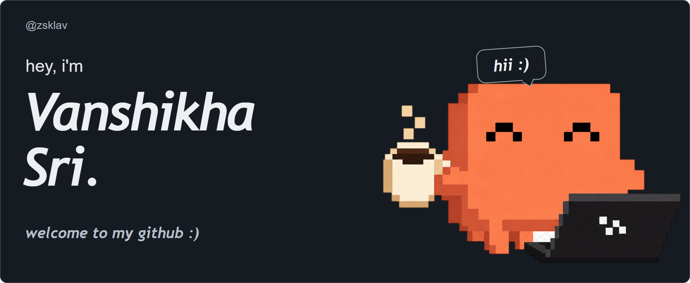
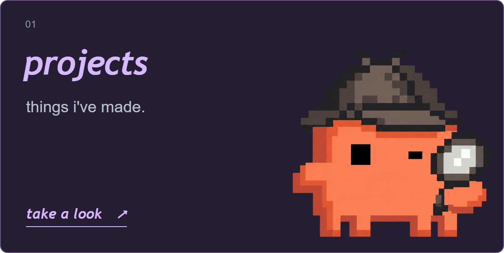
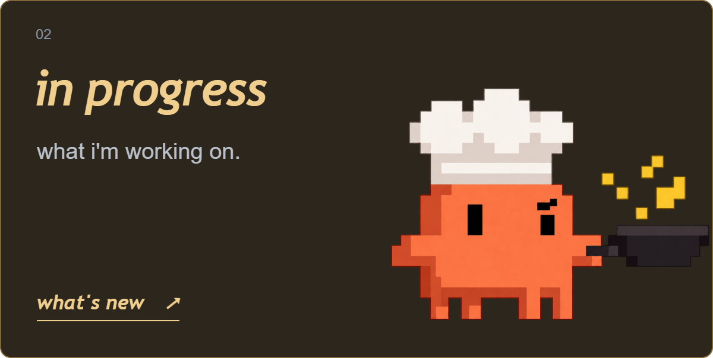
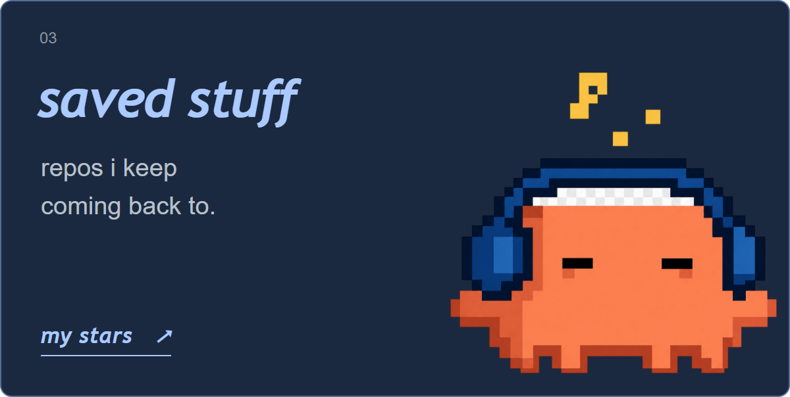
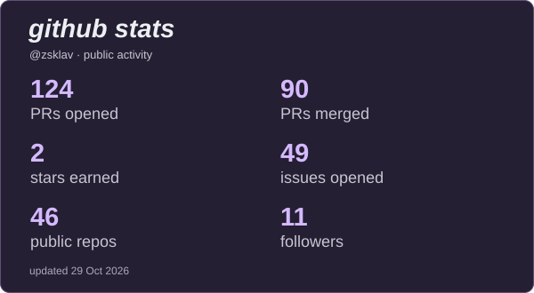
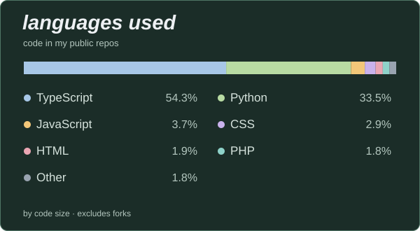
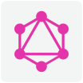
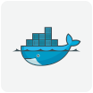
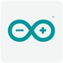

<!-- Vanshikha Sri / @zsklav. Editable design: scripts/build-readme.cjs. Logo sources: assets/logos/manifest.json. -->

  
  
  

  

  

  
  

  
  

<h3 align="center"><em>github stats</em></h3>

  
  

<h3 align="center"><em>stuff i use</em></h3>

  <strong><em>languages</em></strong>  
  
  
  
  
  
  
  
  

  <strong><em>frontend</em></strong>  
  
  
  
  
  

  <strong><em>backend &amp; APIs</em></strong>  
  
  
  
  
  
  

  <strong><em>data &amp; messaging</em></strong>  
  
  
  
  
  
  
  

  <strong><em>cloud &amp; platforms</em></strong>  
  
  
  
  
  

  <strong><em>tools &amp; workflow</em></strong>  
  
  
  
  
  
  
  
  
  
  

  

